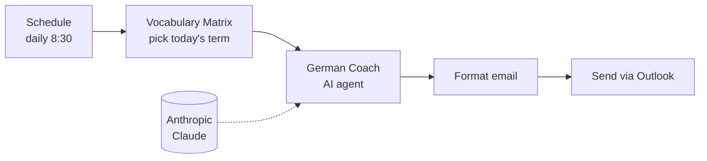

# C1 German Booster (Der C1-Booster)

A daily German business vocabulary lesson at C1 level, delivered by email at 8:30 every morning.

Each email contains:
- **Word of the day:** a business term with its English meaning
- **In context:** a short boardroom-style paragraph in which an executive uses the term naturally
- **Your challenge:** a business scenario that asks you to write your own sentence with the term

## How it works

## Design notes

- **Deterministic rotation:** the term is chosen from the number of days since 1970 modulo the list length. Every day gets the next term, the result doesn't depend on any stored state, and you can reproduce which term is sent on any date.
- **Structured prompt:** the system prompt defines fixed sections, a C1 formal register (Sie-Form), and phone-friendly formatting, so the output is consistent from day to day.
- **Separating content from generation:** the vocabulary list is editable data. The model writes the lesson but doesn't choose the word.

## Setup

1. Import `c1-german-booster.json`.
2. Add credentials: Anthropic API key and Microsoft Outlook OAuth2.
3. Set your email address in **Send Daily Email**.
4. Add more terms to **C1 Vocabulary Matrix**. With the current 5 terms, the cycle repeats every 5 days.
