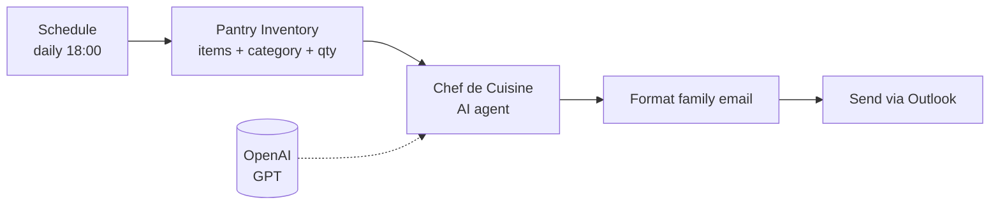

# Culinary Orchestrator (L'Orchestrateur Culinaire)

At 6 PM every day, "Chef Léon" looks at what's in your pantry and emails one dinner recipe that takes **under 20 minutes and uses only ingredients you already have**.

## How it works

## Design notes

- **Grounded generation:** the inventory is turned into a plain-text list and passed to the model. The system prompt forbids ingredients that aren't on the list, which keeps the recipes realistic.
- **Fixed output shape:** recipe name, total time, ingredients, and 4–6 numbered steps, so the email always reads the same way.
- **Persona and tone:** a friendly, family-oriented chef character makes the daily email pleasant to read.

## Setup

1. Import `culinary-orchestrator.json`.
2. Add credentials: OpenAI API key and Microsoft Outlook OAuth2.
3. Set your email address in **Send Family Email**.
4. Update the list in **Pantry Inventory Matrix** when you shop.

## Possible extension

Read the inventory from a Google Sheet or Notion database so it can be updated from your phone, without opening n8n.
