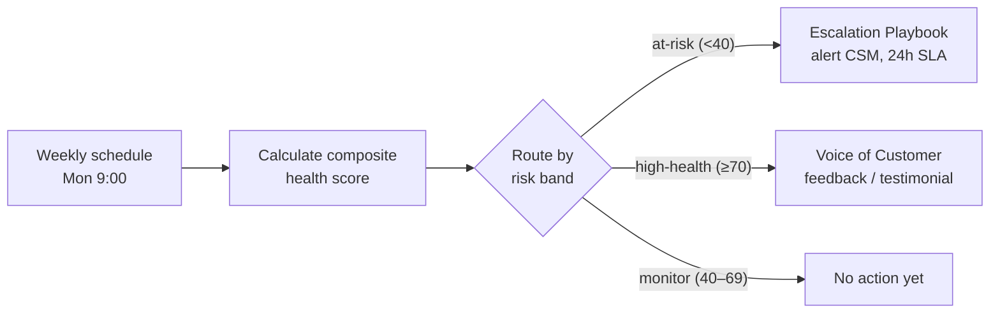

# Customer Health Scoring & Retention Routing

Every Monday at 9:00, this workflow scores each customer account from 0 to 100 and sends it to a retention playbook based on its risk level. At-risk accounts are escalated to their Customer Success Manager with a 24-hour SLA. Healthy accounts are invited to a Voice of Customer program.

## How it works

## Scoring model

| Component | Weight | Signal |
|---|---|---|
| Engagement | 40% | Logins in the last 30 days (capped at 100) |
| Adoption | 25% | Percentage of purchased seats in use |
| Support load | 20% | Open tickets (inverse: more tickets lowers the score) |
| Sentiment | 15% | NPS score |

**Risk bands:** under 40 is `at-risk`, 40–69 is `monitor`, and 70 or above is `high-health`.

Because the weights are stored as code, they're easy to adjust and review. A Customer Success team could tune them without touching the routing.

## Current scope

This version is the **scoring and routing engine**, running on sample data with fictional accounts. It produces the alert and invitation messages but doesn't send them yet.

Planned next steps:
- Replace the sample data with a CRM or database source (e.g. HubSpot, Salesforce, Postgres)
- Deliver at-risk alerts to Slack or email, and log Voice of Customer invites to a sheet
- Add a weekly digest for accounts in the `monitor` band

## Setup

1. Import `customer-health-scoring.json` (no credentials needed in its current form).
2. Run it manually and check each branch's output.
