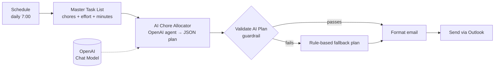

# Smart Chore Allocator (An Córas Glic)

Every morning at 7:00, this workflow picks a few apartment chores that fit a **20-minute budget with at most one high-effort task**, rotates them through the week, and emails the plan.

The interesting part is the design: the AI makes the choice, but **code checks the result**. If the model breaks a rule, returns invalid JSON, or makes up a chore, the workflow falls back to a rule-based plan, so you still get a valid email instead of an error.

## How it works

| Node | Role |
|---|---|
| **Master Task List** (Code) | Single source of truth: each chore has a name, an energy rating (High / Medium / Low) and an estimate in minutes |
| **AI Chore Allocator** (Agent) | Picks today's chores, varying by weekday. The system prompt states the rules and requires a strict JSON response |
| **Validate AI Plan** (Code) | Parses the output, rejects unknown chores, **recalculates time and effort from the master list** instead of trusting the model's numbers, and checks both rules |
| **Fallback** (in the same node) | Rotates the list by weekday and fills it greedily within the rules, so the result is deterministic and always valid |
| **Error Notifier** (separate workflow) | Uses n8n's Error Trigger to email the failed node and error message if anything still breaks |

## From v1 to v2: adding a guardrail

[`smart-chore-allocator-v1-no-guardrail.json`](smart-chore-allocator-v1-no-guardrail.json) sent the model's output straight to `JSON.parse()` and trusted it. That leaves three ways to fail:

- The model wraps the JSON in markdown code fences, so parsing throws and no email is sent.
- The model adds up the minutes wrong or picks two high-effort chores, so the plan breaks the rules without anyone noticing.
- The model makes up a chore that isn't on the list.

v2 ([`smart-chore-allocator.json`](smart-chore-allocator.json)) treats the LLM as a suggestion engine and **enforces the rules in code**. The email also says when the fallback was used and why, so failures are visible but don't stop delivery.

## Files

- `smart-chore-allocator.json`: current version, with the guardrail
- `smart-chore-allocator-error-notifier.json`: error-alert workflow
- `smart-chore-allocator-v1-no-guardrail.json`: first version, kept for comparison

## Setup

1. Import `smart-chore-allocator.json` and `smart-chore-allocator-error-notifier.json`.
2. Add credentials: OpenAI API key and Microsoft Outlook OAuth2.
3. Set your email address in both Send Email nodes.
4. In the main workflow, open **Settings → Error workflow** and select the Error Notifier.
5. Edit the chore list in **Master Task List** to match your home.
